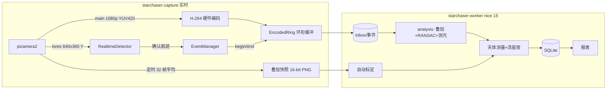

# StarChaser 设计文档

## 1. 目标与约束

| 项目 | 约束 / 目标 |
|---|---|
| 主机 | 树莓派 Zero 2W：4×Cortex-A53 @1GHz，**512MB 内存**，VideoCore IV 硬件 H.264 编码 (≤1080p30) |
| 相机 | CSI 星光级传感器 (推荐 IMX462/IMX290) + 鱼眼镜头 (≈180°)，也支持 USB 摄像头 |
| 运行 | 24 小时无人值守，断电/崩溃后自动恢复，SD 卡写入量可控 |
| 输出 | 流星视频 (含触发前)、关键帧、每帧天球坐标、角速度、星等、流星雨归属、每晚报表 |

核心矛盾是**算力/内存很小，但要不漏掉持续仅 0.2–1 秒的流星**。为此采用：

1. **硬件编码 + 编码后缓存**做预录：已编码视频 8 Mbps × 5 s ≈ 5 MB，若缓存原始帧则要 1080p × 125 帧 ≈ 390 MB，Zero 2W 放不下。
2. **两级检测**：实时级在 640×360 上做宽松检测 (宁可多录)，精确判别放到离线、低优先级的处理进程。
3. **两个独立进程**：采集进程只做必须实时完成的事；处理进程崩溃不影响采集，事件以目录为单位通过 `inbox/` 交接 (写完才原子改名，保证不会读到半个事件)。

## 2. 进程与数据流



### 2.1 昼夜调度

太阳高度 < `night_sun_altitude` (默认 -10°) 时启动相机进入夜间会话，天亮后释放相机。白天处理进程把当夜标记为"已结束"并收尾 (标定精修 → 重算坐标 → 合成图 → 报表 → 清理)。"观测夜"按**地方平太阳时 - 12 小时**取日期，与系统时区无关，跨午夜的同一夜归到同一目录。

### 2.2 资源预算 (估算，需在真机上核实)

| 进程 | 主要内存 |
|---|---|
| 采集 | 相机缓冲 (CMA) 6×(3.1+0.35) MB ≈ 21 MB；H.264 环形缓冲 ≈ 6 MB；检测器 4 张 640×360 float32 ≈ 4 MB；Python+numpy+OpenCV+picamera2 ≈ 80–100 MB |
| 处理 | 1080×1080 ROI 叠加 (max/maxframe/sum/sum²/彩色 max) ≈ 20 MB；关键帧 ≈ 10 MB；scipy (仅标定时) ≈ 30 MB；基础 ≈ 70 MB |

CPU：H.264 编码由硬件完成；检测器在开发 PC 上 2.2 ms/帧，A53 预计 10–25 ms/帧，单核即可跑 25fps (预算 40 ms)。处理进程 `nice 15` + 单线程 OpenCV，只使用空闲 CPU。

## 3. 实时检测 (detector.py)

每帧 (lores 灰度):

1. `diff = frame − bg`，阈值 `thr = max(k·σ, min_delta)`，逐像素 σ 由 |diff| 的指数滑动平均 ×1.2533 (平均绝对偏差 → 标准差) 估计。**闪烁的亮星、RTS 噪声像素的 σ 自然变大**，不需要单独的星点掩膜。
2. 背景 EMA 只在未检出处更新 (流星不会污染背景)；每 16 帧做一次慢速全图更新，让新亮起的灯等持久变化融入背景。
3. 检出像素占比 > 2% 或斑点数 > 60 → **全局变化** (闪电、车灯扫过、云、增益调整)，本帧丢弃、清除未确认航迹。
4. 斑点：少量像素时直接聚类，否则膨胀后做连通域；取信号加权质心。
5. 航迹关联：按速度线性外推预测位置，门限随速度放大；最多允许 2 帧缺失。
6. 确认条件：≥4 帧 (快速流星 3 帧且位移更大)、位移 ≥ 2 px、速度 ≥ 0.15 px/帧 (≈2°/s)、主方向上单调、垂直残差 ≤ 1.2 px。超过 5 秒的航迹 (飞机、卫星) 丢弃。

确认后 `EventManager` 计算预录起点 = 航迹首帧时间 − `pre_seconds`，调用录像器 `begin()`；所有确认航迹结束 `post_seconds` 后 `end()`，写 `meta.json` 并把目录改名交给处理进程。每小时触发上限防止雨滴/昆虫造成的"触发风暴"写满存储。

## 4. 预录像 (prerecord.py)

`EncodedRing` 是 picamera2 的 `Output` 子类，挂在 `H264Encoder(repeat=True, iperiod=25)` 后：

- 编码器线程回调 `outputframe()`：未录像时把 (数据, 是否关键帧, 时间戳) 放入按时长裁剪的 deque；录像中直接写文件。
- `begin(pre)`：在缓冲中找到**不晚于 (当前 − pre) 的最后一个关键帧**，从那里开始写盘——`repeat=True` 使每个 I 帧都带 SPS/PPS，片段可独立解码。I 帧间隔 1 秒，所以实际预录时长在 pre 到 pre+1 秒之间。
- 编码器时间戳是相对微秒；以 `begin()` 时刻当前帧的墙钟时间为锚点换算每帧绝对时间 (误差约 1–2 帧，对单站天体测量足够)。

`FrameRing` 是同一接口的通用实现 (USB 摄像头、视频文件仿真)，缓存原始帧，触发时写 MJPG。

## 5. 离线分析 (analysis.py)

1. **流式叠加** (内存恒定)：`maxpixel`、`maxframe` (每像素最亮的帧号)、去掉最大值后的 `avepixel`/`stdpixel`。只处理掩膜外接矩形 (鱼眼像圈)，1920×1080 中只算 1080×1080。
2. **候选像素**：`maxpixel − avepixel > k·σ`，σ 取 `min(std, 5×5 中值)` 以抵消慢速流星多帧经过同一像素造成的 σ 抬高；去掉面积 < 3 的孤立点。
3. **RANSAC (x, y, 帧号)**：流星是随时间近似匀速移动的点，因此像素的最亮帧号必须沿轨迹线性递增。随机取两个邻近候选点构成运动假设，按"垂直距离 ≤ 3 px 且沿轨迹偏差 ≤ 0.75×每帧位移 + 3 px"计内点；精修时用加权最小二乘，帧数 ≥ 10 时允许二次项 (鱼眼投影弯曲 + 减速)。剥离内点后重复，可提取同一片段中的多颗流星。
   - 闪烁的星：位置固定、帧号随机 → 不满足时间单调
   - 飞机频闪：时间上断续 → 覆盖率低；匀速但太慢/太长 → 角速度、时长不合格
4. **每帧质心** → 多项式平滑 → 第二遍解码做孔径测光 (半径随速度增大)、饱和检测，同时截取起点/峰值/终点帧与逐帧小图。
5. **判别**：帧数、长度、直线度、时间覆盖率 ≥ 50%、时长 ≤ 8 s、角速度 1.5–90°/s。未通过的进入 `rejected/` 并记录原因。

## 6. 全天镜头模型与自动标定 (calibration.py)

模型 (8 个连续参数 + 镜像标志)：

```
ρ = |p − c| / R,   θ = k1·ρ + k2·ρ² + k3·ρ³           # 离光轴角距 (径向多项式覆盖等距/等立体角等各类鱼眼)
ψ = atan2(dy, dx)  (镜像时取负)
v_cam = (sinθ cosψ, sinθ sinψ, cosθ)
v_enu = Rx(tilt_x) · Ry(tilt_y) · Rz(roll) · v_cam     # 东-北-天坐标，允许相机不完全朝天顶
```

反投影 (天球 → 像素) 用牛顿法反解 θ(ρ)。

**盲标定**流程 (只需要站点经纬度和快照时间)：

1. 在 32 帧平均快照中检测星点 (形态学开运算去星 → 背景；局部极大 + 5σ；剔除孤立热像素；质心与通量)。
2. 耶鲁亮星表 (BSC5，5080 颗，V ≤ 6) 经岁差 (IAU 1976)、地平变换、大气折射得到当时的视位置。
3. 粗搜索：roll 每 2°、镜像 ×2、焦距尺度 ×5 共 1800 种组合，统计最亮 80 颗星在 1.5° 内的匹配数，取最大者。
4. 逐级收紧匹配容差 (2° → 0.35°)、逐步放开参数，`scipy.optimize.least_squares` (soft-L1 鲁棒损失) 最小化单位向量残差；匹配采用互为最近邻。
5. 测光零点 `zp = median(m_cat + 2.5·log10(flux))`，记录对应增益；流星星等按增益比例修正。

合成数据测试 (960×540、像元约 20′)：从完全未知的朝向出发，恢复 roll 误差 < 0.2°，方向误差中位数 < 1.5′。每晚收尾时用当夜最佳快照以现有标定为初值精修，劣化超过 50% 则拒绝更新；标定变化后用 `event.json` 中保存的像素轨迹重算天球坐标，无需重新解码视频。

## 7. 天体测量与流星雨归属

- 像素 → 视高度/方位 → 去折射 (Bennett) → 赤道坐标 (当时) → 岁差回 J2000。忽略章动/光行差 (~20″)，远小于像元。
- 角长度、角速度 (首末帧中点时间)、每帧赤经赤纬。
- **流星雨归属** (单站法)：辐射点按 IMO 表中的太阳黄经漂移推算到当时；要求 ① 辐射点到流星轨迹大圆的角距 ≤ 3° + 2·D·σ/L (D 为辐射点到轨迹中点的距离，L 为轨迹长度，短轨迹容差更大，上限 10°)；② 流星远离辐射点运动；③ 起点距辐射点 < 90°；④ 辐射点高度 > −5°。多个候选取归一化距离最小者，否则为偶发 (SPO)。

## 8. 存储与可靠性

- 事件目录原子交接；处理异常的事件移入 `failed/`，不阻塞队列。
- `systemd` 看门狗：采集循环每 15 秒、白天每 5 秒报活，卡死 120 秒自动重启。
- 空间管理 (每晚收尾)：被拒视频 → 过期快照 → 超过 `keep_video_days` 的流星视频 → 剩余空间低于 `min_free_gb` 时删除最旧的流星视频。图片与 JSON 永远保留 (每颗流星约 1–2 MB)。
- 状态 `status.json` (模式、帧率、丢帧、增益、背景亮度、CPU 温度、剩余空间、今晚事件数) 每 15 秒更新，首页实时显示。
- 时间：天体测量依赖准确时钟，安装脚本会检查 NTP 同步；离线站点需要 RTC (DS3231) 或 GPS 模块。

## 9. 可扩展方向

- 多站联测：`event.json` 已含每帧时间与赤经赤纬，可输出为 UFOOrbit / GMN 格式做三角测量求三维轨道与轨道根数。
- 推送通知 (火流星、星等 < −4 时发消息)、上传到云存储。
- 除露加热器温湿度控制 (GPIO + MOSFET)、云量统计 (快照星数)。
